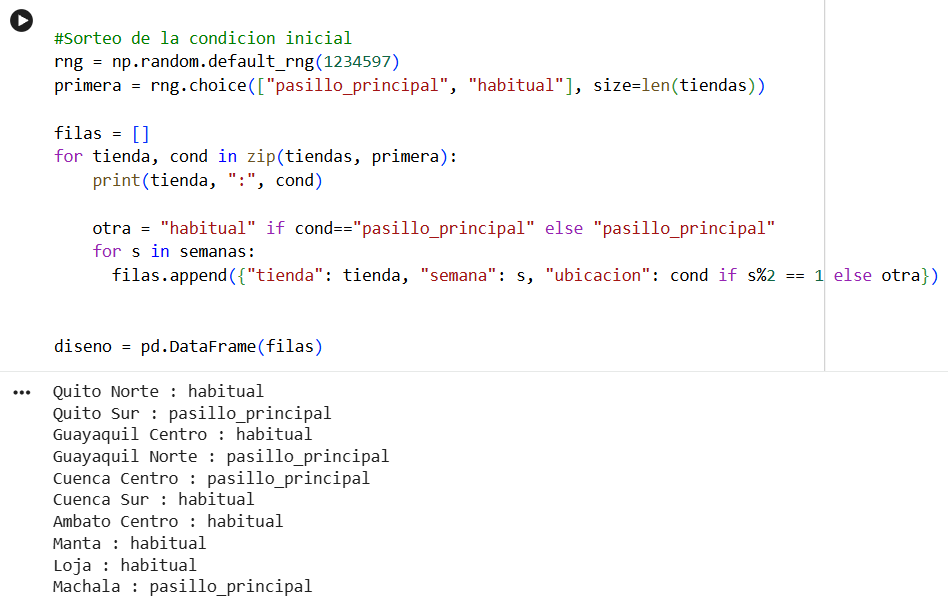

# Plantilla de protocolo — Experimento de ubicación de producto

**Equipo:** ___ · **Integrantes:** ___ · **Fecha:** 27/10/2026

Completa cada sección. Usa commits por sección; la historia del repositorio se revisa.

## 1. Pregunta e hipótesis

**Pregunta:** ¿El producto estrella de RetailAndina genera mayores ventas semanales cuando se encuentra en el pasillo principal que cuando permanece en su ubicación habitual?

**Hipótesis:** El producto ubicado en el pasillo principal genera mayores ventas promedio semanales en USD que en su ubicación habitual durante un período de cuatro semanas.

- H0: Las ventas promedio semanales en el pasillo principal son menores o iguales a las ventas en la ubicación habitual.

- H1: Las ventas promedio semanales en el pasillo principal son mayores que las ventas en la ubicación habitual.


## 2. Unidad experimental

- Unidad: Semana-Tienda (**# de tiendas x # de semanas**)

- Número de unidades y justificación:

10 tiendas × 4 semanas = 40 unidades tienda-semana.

1. 20 unidades tienda-semana con el producto en el pasillo principal.

2. 20 unidades tienda-semana con el producto en la ubicación habitual.

Se utilizarán 10 tiendas durante cuatro semanas para comparar las ventas del mismo producto en ambas ubicaciones. Cada tienda tendrá el producto dos semanas en el pasillo principal y dos semanas en su ubicación habitual.

Esto permitirá comparar las ventas dentro de una misma tienda y reducir la influencia de características propias del establecimiento.

Aunque se obtendrán 40 registros, estos corresponden a 10 tiendas diferentes, por lo que las mediciones repetidas de una misma tienda deberán considerarse al analizar los resultados.

## 3. Factor, niveles y tratamiento

- **Factor** (variable manipulada): Ubicación del producto estrella dentro de la tienda.
- **Niveles** (valores del factor): Pasillo principal y ubicación habitual.
- **Tratamiento** (combinación asignada): pasillo durante una semana y ubicación habitual durante otra (grupo de control).

Cada tienda pasará dos semanas en cada condición. El orden de aplicación será determinado mediante una asignación aleatoria.

## 4. Grupo de control
El grupo de control estará conformado por las unidades semana-tienda en las que el producto permanezca en su ubicación habitual, sin recibir el cambio de ubicación.

La misma tienda podrá formar parte del grupo experimental durante unas semanas y del grupo de control durante otras.

Esto permitirá comparar las ventas del mismo establecimiento bajo ambas condiciones y reducir diferencias relacionadas con el tamaño de la tienda, su ubicación geográfica y sus clientes habituales.

## 5. Aleatorización

Se realizará un sorteo de las 10 tiendas para dividirlas aleatoriamente en dos grupos iniciales de cinco tiendas.

- Grupo A: Durante las semanas 1 y 3 tendrá el producto en el pasillo principal; durante las semanas 2 y 4, en la ubicación habitual.

- Grupo B: Durante las semanas 1 y 3 tendrá el producto en la ubicación habitual; durante las semanas 2 y 4, en el pasillo principal.

De esta manera, cada semana habrá cinco tiendas en cada condición y, al finalizar el experimento, existirán 20 registros de cada ubicación.

- **Línea de código de la asignación (Python o R):** 

```python

rng = np.random.default_rng(1234597)
primera = rng.choice(["pasillo_principal", "habitual"], size=len(tiendas))

```



Se muestra el resultado del sorteo realizado con la semilla 1234597, donde se asigna aleatoriamente la ubicación inicial del producto en las 10 tiendas. Esta asignación permite organizar la alternancia entre el pasillo principal y la ubicación habitual durante las cuatro semanas del experimento.

## 6. Respuesta y medición

- Variable respuesta: Ventas semanales del producto estrella en USD.
- Período de medición: 4 semanas consecutivas.
- Quién registra y cómo (¿ciego?): Las ventas serán registradas automáticamente mediante el sistema POS (punto de venta) de cada tienda. El equipo de análisis recopilará los datos semanalmente.
- Ciego: Los vendedores no podrán estar completamente ciegos al tratamiento, porque pueden observar la ubicación del producto. Sin embargo, el registro automático mediante POS reduce la intervención del personal en la medición.

## 7. Factores a controlar (mínimo 4)

| Factor a controlar | Cómo se controla o registra |
|---|---|
| 1. Clima | Registrar condiciones climáticas relevantes, como lluvias intensas, que puedan reducir la asistencia de clientes.|
| 2. Evento local | Registrar feriados, festividades u otros eventos que puedan aumentar o disminuir las ventas de determinadas tiendas.| 
| 3. Surtido/Stock | Mantener suficiente inventario del producto en ambas ubicaciones y registrar los casos en que se agote.| 
| 4. Cambios en el personal | Registrar cambios importantes de empleados y procurar mantener condiciones similares de atención al cliente.| 
|5. Promociones |Evitar promociones diferentes entre las condiciones y registrar cualquier promoción del producto o de sus competidores. |
|6. Precio | Mantener el mismo precio del producto durante las cuatro semanas para evitar que sus variaciones influyan en las ventas. |

## 8. Limitaciones del diseño

- Promociones de productos competidores: Si otro producto similar tiene descuentos o promociones, puede disminuir las ventas del producto estrella y alterar los resultados.

- Canibalización entre tiendas: Dos establecimientos cercanos de RetailAndina pueden competir por los mismos clientes. Esto podría provocar que una tienda venda más mientras otra disminuye sus ventas.

- Factores externos: El clima, los eventos locales o los cambios en el personal pueden influir en las ventas, aunque se registren durante el experimento.

- Cambios semanales de ubicación: Mover el producto entre ubicaciones puede generar efectos que permanezcan de una semana a otra, como clientes que continúen buscándolo en su ubicación anterior.

- Tiempo limitado: Cuatro semanas pueden ser insuficientes para identificar efectos que se mantengan a largo plazo.


## 9. Comparación en código (Python/R)

Se utilizará el archivo plantillas/registro_experimento.csv para comparar el promedio de ventas_producto por ubicacion mediante los scripts de Python.

*Escribe `scripts/comparacion_experimento.py` (o `.R`): debe cargar `plantillas/registro_experimento.csv` y calcular el promedio de `ventas_producto` por `ubicacion`. Incluye la salida y responde:*

- ¿Qué grupo muestra mayor venta promedio en la plantilla?
El pasillo muestra 1335 USD en venta frente a 1040 USD en habitual.

- ¿Por qué con 4 filas no se puede concluir nada sobre el efecto de la ubicación?
No se puede concluir porque no hay ninguna asignacion real aleatoria, los datos son muy pocos (4) no tenemos control de temporada, ni promociones en el grupo pasillo y no hay media de variabilidad. 


- Si el experimento se ejecutara con tu protocolo, ¿qué le faltaría a este análisis para ser justo?
